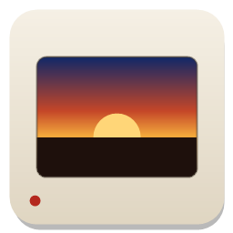
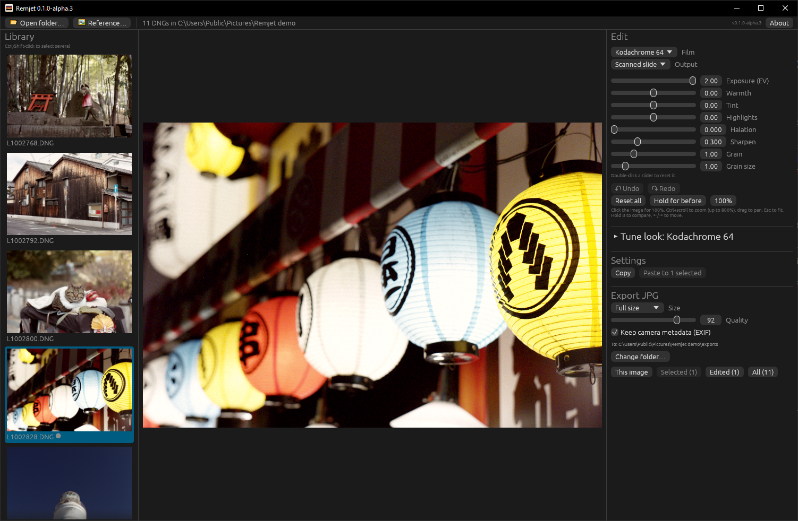
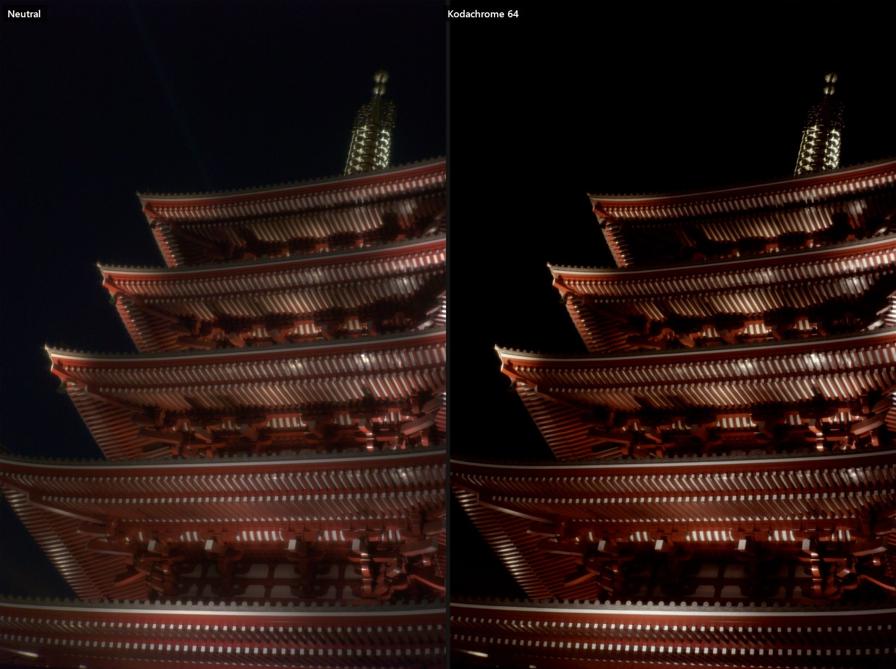
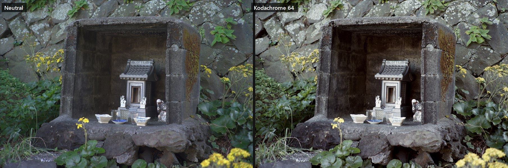
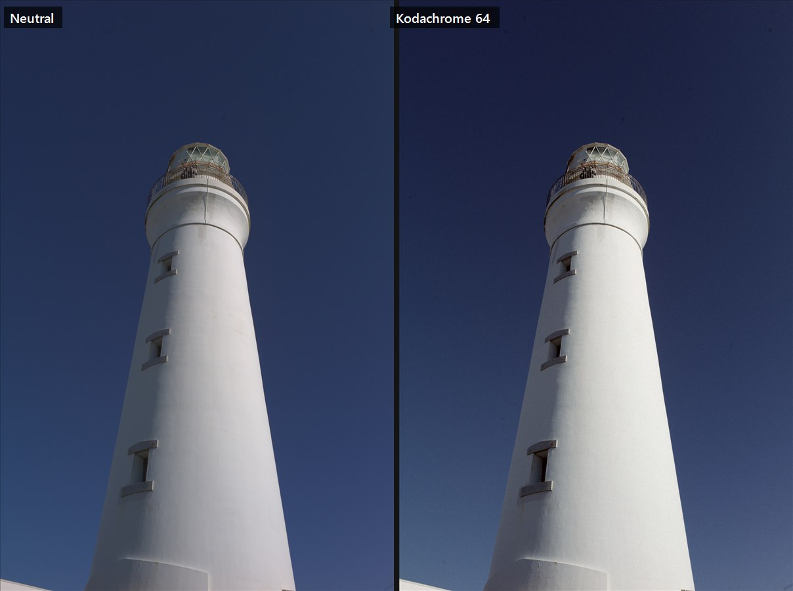
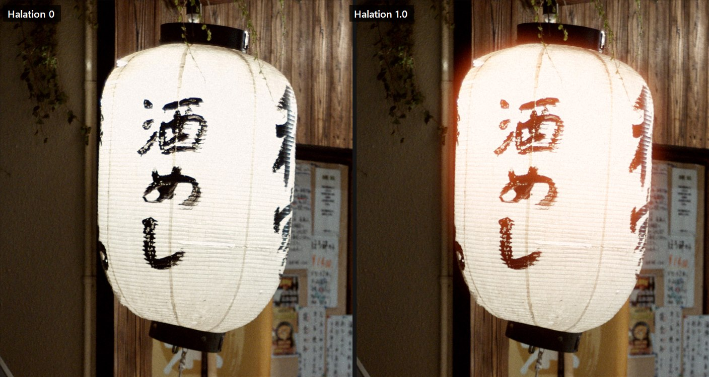

<p align="center">
  
</p>

<h1 align="center">Remjet</h1>

<p align="center">
  Film emulation for <b>Leica M9</b> DNGs, starting with <b>Kodachrome 64</b>, as it looks on a scanned slide.<br>
  <i>Alpha · Windows · free and open source (GPL-3.0)</i>
</p>



Remjet develops your M9 raw files through a model of Kodachrome 64 built from Kodak's own
published measurements: the film's density curves and the way its dyes absorb light. It then
"scans" the virtual slide. The result keeps Kodachrome's character: deep, saturated blues, warm
punchy reds and yellows, dense brown-black shadows and fine grain.

> **Alpha software.** It works well on the files it was developed with, but expect rough edges.
> Your DNGs are never modified. Please [report issues](https://github.com/Tyrannik/remjet/issues).

*Remjet was called Kodachromer up to 0.1.0-alpha.2. The name comes from the carbon-black
backing layer on Kodachrome and cine film. Upgrading keeps your edits and settings.*

## Before and after

Neutral camera render (left) vs. Kodachrome 64 (right), straight out of Remjet with default settings:





Optional **halation**, the red glow around bright lights that film without an anti-halation layer shows
(off by default, since real Kodachrome had one):



## Features

- **Kodachrome 64, built from Kodak data.** Characteristic curves and dye cross-absorption are
  digitised from Kodak publication E-55. A virtual scanner then gives the scanned-slide look.
- **Ektachrome E100, E100VS and E200, Portra 160, 400 and 800, Ektar 100, Gold 200 and Ultramax 400,
  modelled from their spectra.** Layer sensitivities, dyes, curves and sharpness all come from Kodak's
  datasheets (E-4000, E-163, E-28, E-4051, E-4050, E-4040, E-4046, E-7022, E-7023). The negatives are shown as a lab scan of the negative,
  or as an optical print on Endura Premier paper (E-4070).
- **Tri-X 400, T-Max 100 and T-Max 400 in black and white**, from Kodak's F-4017, F-4016 and F-4043:
  their D-76 curves, panchromatic sensitivity, MTF and rms granularity, shown as a lab scan of the negative.
- **Push and pull development:** Tri-X and T-Max use Kodak's measured D-76 curves; the colour films use
  pushes modelled on Kodak's measured Portra 800 push data (Portra 800 itself uses those measured curves), labelled "modelled" in the app.
- **Per-image controls:** exposure, warmth, tint, highlights, halation, sharpen, grain, grain size.
  Double-click any slider to reset it.
- **Tune the film itself:** brightness, contrast, saturation, shadow lift, black depth, scanner
  colour and grain, previewed live. Save it, restore Kodak defaults, or save variants as new films.
- **Fast, smooth viewing:** live preview while dragging sliders; click for 100%, Ctrl+scroll up to
  800%, and drag to pan without lag.
- **Non-destructive, clean folders:** edits are kept in Remjet's own data folder (nothing is
  written next to your photos) and follow a file even if you move or rename its folder.
  Full **undo/redo** (Ctrl+Z / Ctrl+Y).
- **Scanned or projected:** view the slide as a film scanner reads it (open shadows) or as it looks
  projected on a screen (full density range, deep blacks, warm lamp, soft corner falloff).
- **Batch work:** select several images, copy and paste settings, and export one, selected, edited or
  all images to JPG, with progress and cancel. Export a whole shoot in one look (any film, keeping
  each frame's own adjustments, or one frame's settings for all) without changing your edits.
- **Good exports:** full-resolution or resized JPGs with 4:4:4 colour and camera metadata (date,
  shutter speed, ISO, focal length).
- **Compare:** hold **B** for before/after; split the photo with a draggable divider or show two
  versions side by side (zoomed together), against the unfilmed frame or another film; or open a
  real Kodachrome scan beside your photo with **Reference…**.

## Download

Get the latest `Remjet-<version>-windows-x64.zip` from the
[Releases page](https://github.com/Tyrannik/remjet/releases), unzip it anywhere, and run
`remjet.exe`. There is no installer. Release builds are made by GitHub Actions directly
from the tagged source code.

**Requirements:** 64-bit Windows 10 or 11, a GPU with DirectX 12 or Vulkan support (any recent
integrated GPU works), and about 2 GB of free RAM for full-resolution zoom and export.

**Windows SmartScreen** may warn that the app is from an unknown publisher, because builds are not
code-signed yet (free signing through SignPath Foundation is being applied for; see
[Code signing policy](#code-signing-policy)). Choose *More info → Run anyway*, or build it yourself
from source (below).

## Using it

1. **Open folder…** and choose a folder of M9 DNGs. Thumbnails appear in the library.
2. Pick an image. It renders as Kodachrome 64; adjust it with the sliders on the right.
3. **Export JPG**: this image, the ones you've selected, every edited image, or the whole folder.
   By default JPGs go to an `exports` folder next to your DNGs.

| Action | How |
|---|---|
| Next / previous image | **→ / ←** |
| Before / after | hold **B** (or *Hold for before*) |
| Split / side by side compare | **C** cycles (or *Compare* under the photo) |
| 100% at a point / back to fit | click the image; **Z** toggles; **Esc** fits |
| Zoom in and out (up to 800%) | **Ctrl + mouse wheel** |
| Pan | drag the zoomed image |
| Select several images | **Ctrl**-click, **Shift**-click, **Ctrl+A** |
| Copy / paste settings | **Ctrl+C / Ctrl+V** (pastes to all selected; a message confirms each) |
| Undo / redo | **Ctrl+Z / Ctrl+Y** (or Ctrl+Shift+Z) |
| Reset a slider | double-click it |

### Where things are saved

- **Edits:** `%APPDATA%\Remjet\edits`, one small file per image, matched to the DNG by its
  contents, so they survive moving or renaming folders. (Exact copies of the same DNG share an
  edit.) *Reset all* returns an image to unedited. Edit files left beside DNGs by 0.1.0-alpha.1 are
  moved into the store automatically when you open the folder.
- **App settings and tuned films:** `%APPDATA%\Remjet`. To keep everything elsewhere (for example
  on a USB stick), set the environment variable `REMJET_DATA_DIR` to a folder.
- **Exports:** `<your folder>\exports` unless you choose another folder.

## How the Kodachrome 64 emulation works

1. The DNG is decoded and turned into accurate, scene-referred colour using the camera's own
   colour profile.
2. That light exposes a virtual Kodachrome 64 with three dye layers, each with its own sensitivity.
3. Each layer develops along **Kodak's measured density curve**. The dyes' unwanted
   absorptions, digitised from Kodak's spectral data, are added back. Most of Kodachrome's colour
   character comes from this step.
4. Grain is added in film density, clumped like dye clouds and stronger in denser areas.
   Optional halation is added before development.
5. A virtual **scanner** reads the slide: white at the clear film base, a scanner black point,
   grey balance and a touch of warmth, as a well-made 4000 dpi Kodachrome scan looks.

There are more details in [docs/DEVELOPMENT.md](docs/DEVELOPMENT.md).

## Known limitations (alpha)

- **Leica M9 only.** Other DNGs may open but haven't been tested, and the film was tuned for the
  M9's sensor.
- **Windows only** for now. The processing core is UI-free, so macOS and iOS builds are possible later.
- **Clipped highlights stay clipped:** if the camera blew a channel, there is no detail to recover.
  The Highlights slider shapes what *is* there.
- **The first 100% view of an image** takes a second or two while the full-resolution frame renders.
- **Not in exports yet:** aperture and lens name, which the M9 doesn't store in standard EXIF.
  Exports also carry no embedded ICC profile (they are sRGB).
- **Unsigned binaries,** hence the SmartScreen warning.

## Command line

`remjet-cli.exe` ships with the app:

```powershell
# Export a folder using each DNG's saved edits (resized to 2048 px, edited images only)
remjet-cli export "D:\Photos\Japan" --max-edge 2048 --edited-only
# Export the whole shoot as Portra 400, keeping each frame's own adjustments
remjet-cli export "D:\Photos\Japan" --film portra400 --film-in-name
# Show what the decoder sees in each file
remjet-cli info "D:\Photos\Japan"
```

## Building from source

Install [Rust](https://rustup.rs) (stable, MSVC toolchain) and the Visual Studio C++ Build Tools, then:

```powershell
git clone https://github.com/Tyrannik/remjet
cd remjet
cargo run --release -p remjet
cargo test --release
```

## Code signing policy

Windows release binaries (`remjet.exe`, `remjet-cli.exe`) are built by
[GitHub Actions](.github/workflows/release.yml) on GitHub-hosted runners, directly from the tagged
source code in this repository. Remjet is applying for free code signing from the
[SignPath Foundation](https://signpath.org). Until that is in place, releases are unsigned.

<!-- After SignPath Foundation approval, replace the sentence above with:
Free code signing provided by [SignPath.io](https://about.signpath.io), certificate by [SignPath Foundation](https://signpath.org).
-->

**Team and roles**

- Committers and reviewers: [Tyrannik](https://github.com/Tyrannik) (sole maintainer)
- Approvers: [Tyrannik](https://github.com/Tyrannik)

Every signed release is approved manually by an approver. All team members use multi-factor
authentication for GitHub and SignPath.

**Privacy policy**

This program will not transfer any information to other networked systems unless specifically
requested by the user or the person installing or operating it. Remjet makes no network
connections: no telemetry, no update checks, no accounts. The only exception is the project link in
the About box, which opens in your web browser if you click it.

## License and credits

Remjet is free software under the **GNU General Public License v3.0 or later**; see
[LICENSE](LICENSE). Raw decoding uses [rawler](https://github.com/dnglab/dnglab) (LGPL-2.1).
The user interface uses [egui](https://github.com/emilk/egui). Other dependencies and their licenses
are listed in [THIRD_PARTY.md](THIRD_PARTY.md).

*Kodachrome* and *Kodak* are trademarks of Eastman Kodak Company, and *Leica* is a trademark of
Leica Camera AG. Remjet is an independent project, not affiliated with or endorsed by either.
The film curves are digitised from Kodak's publicly available technical data, solely to emulate
the film's look.

Sample photographs in this README were taken by the author with a Leica M9.
